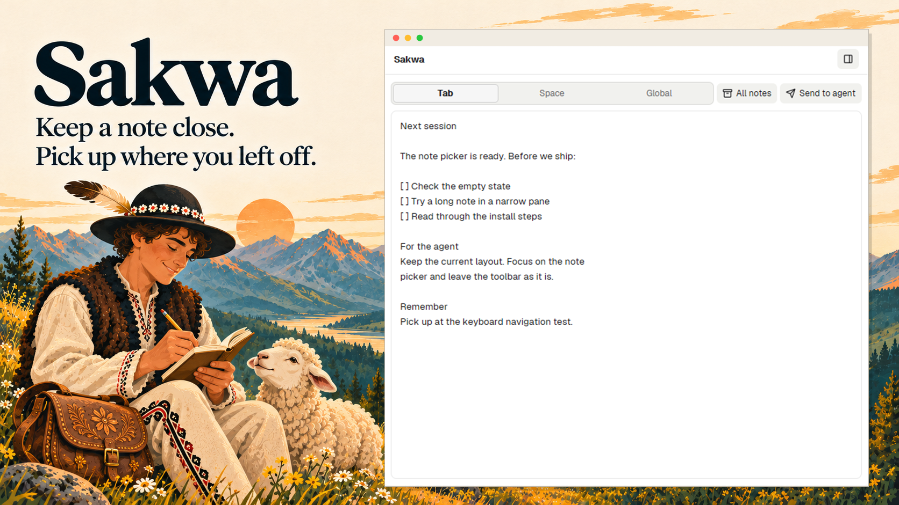

# Sakwa - Notes

Keep a note beside your work in Herdr. Sakwa saves as you type, with a note for each tab, each space, and one for everything else.

## What you see

A native notes panel, initially docked on the right at 380px. The sidebar has a
10px rounded frame, theme border, and a 42px header with Sakwa at the left and an
Open icon at the right. Header text is 13px; horizontal padding is 14px. Detached
tabs and panes use Herdr's frame and omit the Sakwa header.

Inside, use 10px padding and 8px gaps. The toolbar starts with Tab / Space / Global,
an exclusive group of native Buttons in a rounded 7px container. The selected
button has a raised background, stronger text and an input-colored border;
reserve border width on every button to avoid movement. Buttons are 26px high.
All notes and Send to agent follow the selector. At 460px and above they have
labels; narrower views use Lucide icons and tooltips. The toolbar can wrap.

The plain-text editor fills the remaining height. Use a native Textarea with
13px text, 12px horizontal and 10px vertical padding, an 8px radius and theme
border/background. Empty notes show Write a note…. No permanent save indicator
or footer. Native toasts report errors and delivery results.

All notes replaces the editor with a search field and a scrollable list. Each
entry shows scope, context label, active/archived/unavailable state, computer,
date and a short text excerpt. Keep the Back button above the search field.

## How it behaves

The sidebar follows the current tab or space. Global is one note for this local
Herdr installation. Hovering the selector shows the context name. Stable IDs,
not display names, identify notes; renaming or closing a context preserves text.

Save automatically after edits. Coalesce queued writes to the latest pending
text. On errors, retain drafts and retry every three seconds; deduplicate repeated
automatic error toasts. Refresh other-window revisions every ten seconds.

Open offers New tab, Beside and Below in a native popover with a definite 116px
height. Each opens a pinned copy of the original note and hides the source
sidebar. Changing tabs does not retarget a pinned note. Switching scope explicitly
returns to the corresponding current context. Archived notes open pinned.

Send the entire note using hc send only after the user chooses Send to agent.
Tab scope restricts recipients to that tab, Space to that space, and Global
allows live agents across contexts. One eligible recipient sends directly;
several open a picker; none shows an explanation. Working, blocked, done and idle
live agents use the same note UI and recipient logic. Exclude finished terminals;
do not assign different editor layouts to agent statuses. Save before sending,
retain the note afterward, and never retry an uncertain send automatically.

Optional personal toolbar integration toggles the sidebar or focuses a detached
view. Clicking with the detached note focused flushes pending text, returns to
its source tab/sidebar and closes only that view. Prefer focused, current-tab,
source-tab and then most recently opened views. Missing source contexts leave
the note open with an explanation. No navigation picker.

## Built from

Herdr app 0.1.12 JavaScript/GPUI runtime; use its installed AGENTS.md, herdr.d.ts
and gpui-kit.d.ts as the API reference. This is not a Luau mod. No custom layout
or shipped-mod replacement. main.js controls retained native TextareaState and
InputState; ui.js supplies native Button/Popover components and context selection.
context.js owns identity and recipient eligibility; presentation.js opens native
panes/tabs and sends; navigation.js returns pinned views to their source.

journal.js manages immutable schema-1 revisions; persistence.js uses fs/promises
and Herdr writeTextFile with expected=null for atomic, create-only writes under
<app home>/data/sakwa/revisions/<revision-id>.json. Every record includes full
UTF-8 text, context, key, timestamp and parents. drafts.js retains per-copy
localStorage drafts and flushes them before writes. recovery.js also stores
pending drafts in shared sakwa.recovery.v1 so another copy can recover them.
Preserve sakwa.* shared-state keys and journal schema compatibility.

Use spaces, machines, agents, terminals, focused, panes, theme, props, layout,
run, hc, shared/setShared, nextCommand and notify. Commands sakwa.tab,
sakwa.space, sakwa.global and sakwa.all reach shown copies. Runtime needs no
Node or shell process and performs no telemetry or network requests. Sending
uses hc send; the agent can act on the supplied text. Notes, even for remote
contexts, are stored on the local machine and do not sync between computers.

Install with Node 22.15+: node scripts/install.mjs. Honor HERDR_APP_HOME or
~/.config/herdr-app; --app-home selects another installation. Copy only mod
files, exclude generated type/config files, back up replaced mod files under
data/sakwa-install-backups, and preserve notes and personal layouts. Optional
--tabs targets only a supported personal panelButton toolbar, with backup and
compatibility checks. Refuse shipped toolbar mods. Do not silently add shortcuts.

Sakwa is Apache-2.0 licensed. Preserve LICENSE, NOTICE, THIRD_PARTY_NOTICES.md
and the bundled Lucide notices. Promotional art belongs to the same illustrated
Tatra/sheep family as Juhas and Kolczyk; screenshots use synthetic notes rendered
by the real native mod, not a recreated editor.

## Watch out

- Send limit: 16,000 UTF-8 bytes. Reject oversized notes intact; never truncate.
- Concurrent windows append separate revisions. Retain all versions and report
  conflicts. Do not overwrite focused editing text during refresh.
- Preserve unreadable revisions and recovery caches. Unreadable recovery blocks
  editing; never replace it with an empty note. No automatic pruning or History UI.
- Back up the whole Herdr app home, including shared/per-copy recovery stores.
  Writes and the 250ms close callback cannot guarantee the last keystroke survives
  forced termination or hardware failure. History is unbounded in v0.1.
- Use definite popup heights; max-height alone can collapse native content.
  Read pane/overlay props through Herdr props(). Respect single-use native element
  ownership and keep retained input states out of virtual row construction.
- Use semantic theme colors and normal native text editing. Native macOS/Linux
  keyboard, IME and popup behavior requires platform testing; Node tests do not
  establish native acceptance. Remote sending requires separate live acceptance.

## Done when

- npm test passes and herdr-app check mods/sakwa reports no errors.
- Real native editors show the exclusive scope controls and a full-height textarea
  in sidebar and flat pane modes, including narrow views.
- Switching scope restores the correct note; rename/close preserves it in All notes.
- New tab/Beside/Below pin the original note and preserve the existing terminals.
- Recovery retains drafts after a copy closes, write failures and concurrent edits.
- Sending enforces scope and size, retains text, and leaves uncertain delivery for
  the user to inspect. Test real delivery only with an explicitly designated agent.
- Installation preserves unrelated layouts, toolbar content and existing note data.
